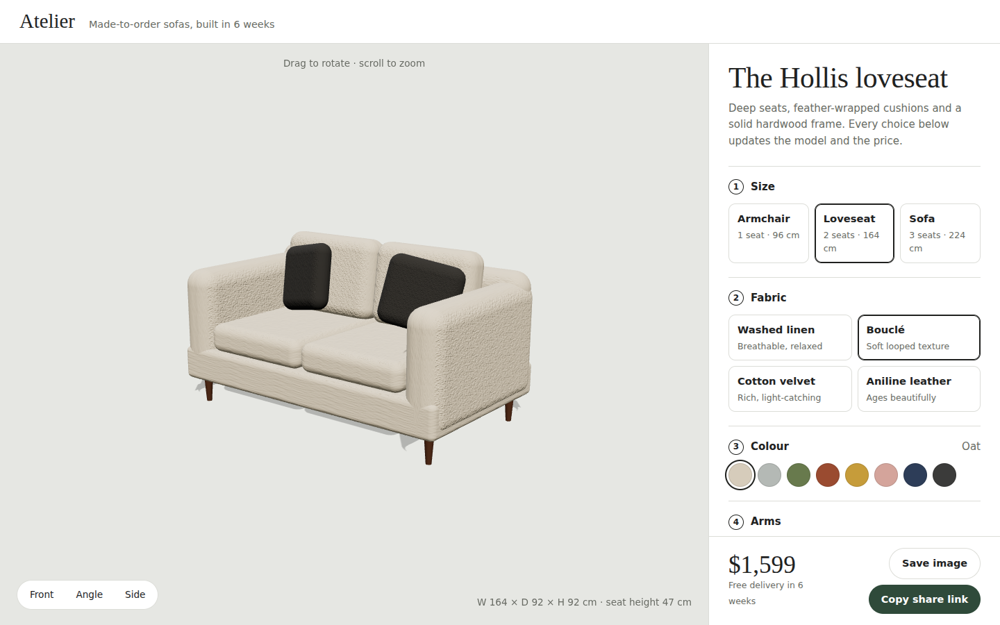

# Atelier

A 3D product configurator for a made-to-order sofa. Every option rebuilds the 3D model and reprices the order instantly.

**Live demo:** https://atelier-yourname.vercel.app ← update after deploying



## Features
- Real-time 3D model built entirely in code (no 3D model files) with Three.js
- Size, fabric, colour, arm style, leg finish, leg height and throw pillows
- Physically based materials: velvet uses a sheen layer, leather a clearcoat, and linen and bouclé use procedurally generated bump textures
- Smooth colour transitions, soft shadows, orbit controls and camera presets (front, angle, side)
- Live price breakdown and real dimensions in centimetres
- **Shareable designs:** the full configuration is stored in the URL, so a copied link reopens the exact sofa
- Save a PNG snapshot of the current view
- Responsive layout: on phones the 3D view stays pinned while you scroll the options

## Tech
Three.js (WebGL), ES modules with an import map, Canvas-generated textures, vanilla JavaScript. No build step, no backend.

## Run locally
```bash
npx serve .
```
